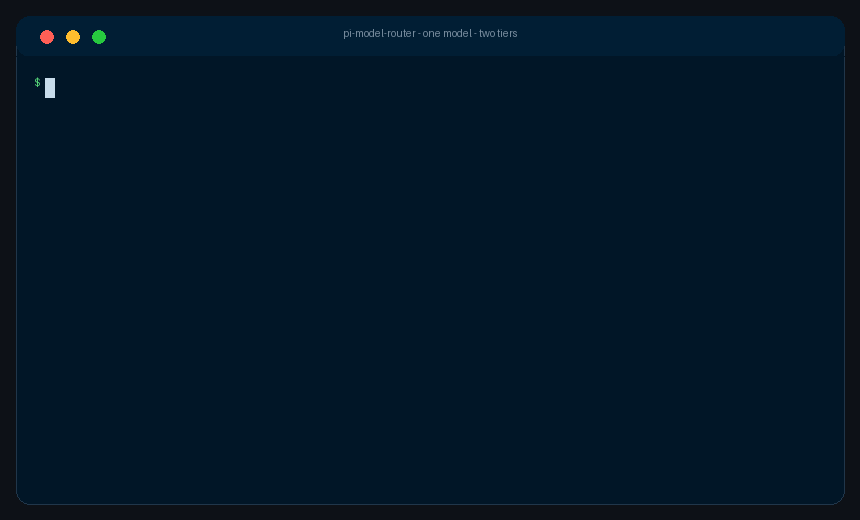

# pi-cuttle

<p align="center">
  
</p>

[](https://github.com/saman-mb/pi-cuttle/actions) [](CHANGELOG.md) [](LICENSE)



**Hybrid local/cloud model routing for [pi](https://github.com/earendil-works/pi-coding-agent).**

Type one prompt. A local classifier decides whether the work belongs on a local model
(free, private) or a cloud model (expensive, capable). The decision is made **once per
session by default**, not per request, so it does not thrash the prompt cache. A
cross-process memory governor stops subagent fanout from loading ten local models at once.

**Host-agnostic:** local models are served by whichever server you already run —
LM Studio, ollama, or any OpenAI-compatible host (llama.cpp, vLLM, …).

- **What changes** — You select one virtual model (`cuttle/auto`); the router dispatches each
  turn to the right physical model. Local, cloud, or let the classifier decide.
- **Why it matters** — Most coding turns are mechanical and do not justify frontier-model cost.
  The classifier runs locally, so the *decision* is free.
- **Who is affected** — Anyone running pi against a local model server (LM Studio, llama.cpp)
  alongside a paid provider, especially with `pi-subagents`.

Status: **working core, live-verified.** See [Verification](#verification).

---

## Part of Cuttle

This is the pi extension for [**Cuttle**](https://github.com/saman-mb/cuttle) — the local-first
agent that gives every piece of work to the cheapest model likely to get it right. It is where
Cuttle's routing (`decide()`) was prototyped, and it is the supported way to run Cuttle-style
routing inside pi.

It is **standalone**. No Cuttle install, no Python, no engine process — everything it needs
lives in this package and talks to your local model server directly over HTTP. If you have
Cuttle checked out, `pi-cuttle` is a useful baseline for it rather than a component of it.

---

## How it works

```
you select:   cuttle/auto                (one model in /model, --model, settings)
                 │
                 ▼
        ┌──────────────────┐
        │  route(request)  │  once per session by default; continuations stay put
        └────────┬─────────┘
                 │
   ┌─────────────┴─────────────┐
   ▼                           ▼
local classifier           heuristic fallback
(System One Jev / chat)    (no model call)
   │                           │
   └─────────────┬─────────────┘
                 ▼
        ┌──────────────────┐
        │  memory governor │  filesystem slot broker (cross-process)
        └────────┬─────────┘
                 │
   ┌─────────────┴─────────────┐
   ▼                           ▼
lmstudio/… (free)        cloud/… (metered)
```

1. **Virtual models** (`pi.registerVirtualModel`) select a physical model per request.
2. **`session_start` selects `cuttle/auto`** — this is how routing becomes the default,
   because `defaultModel` does not resolve an extension virtual model (see spike #24).
3. **Router state** lives on the session branch and survives compaction and forks.
4. **`route()` talks to LM Studio over plain HTTP**, never through another extension's
   hooks, because foreground subagent children do not reload ambient extensions.

---

## Install

```bash
pi install npm:pi-cuttle
# or from git:
pi install git:github.com/saman-mb/pi-cuttle
```

To run a checkout instead of installing it, use `-e` — but only when the package is **not**
already installed. `pi` loads both, and the second registration of the `--cuttle-force` flag is
rejected, which stops the extension loading at all. Remove an installed copy first:

```bash
pi remove git:github.com/saman-mb/pi-cuttle   # or: pi remove npm:pi-cuttle
pi -e /path/to/pi-cuttle
```

pi's error message suggests `pi -ne` for that conflict. Do not use it here: `-ne` disables
built-in extensions, which removes the LM Studio provider, so no local model can be resolved
and every turn spills to cloud.

## Configuration

A single file, `~/.pi/agent/cuttle.json` (project `.pi/cuttle.json` overrides):

```json
{
  "host": "lmstudio",
  "autoSelect": true,
  "classifier": { "model": "lmstudio/vllm-d3-nano", "fallback": "heuristic" },
  "catalog": {
    "local": ["lmstudio/prism-ml/bonsai-27b"],
    "cloud": ["opencode-go/deepseek-v4.1-flash"]
  },
  "policy": { "mode": "complexity", "threshold": 0.5, "reclassify": "session" },
  "local": { "maxConcurrent": 1, "maxLoadedModels": 1, "onFull": "spill" }
}
```

### Hosts

The router talks to each host's native API so the governor can see loaded models and
evict under a ceiling. Capabilities differ, and the router degrades explicitly:

| Host | Inventory | Loaded list | Load/unload | Sizes | Decision models |
|---|---|---|---|---|---|
| LM Studio | ✅ | ✅ | ✅ | ✅ | ✅ System One |
| ollama | ✅ | ✅ | ✅ `keep_alive` | ✅ | ✖ (chat prompt) |
| OpenAI-compatible (llama.cpp, vLLM, …) | ✅ | ✖ | ✖ | ✖ | ✖ |

On hosts without loaded-model introspection the governor still caps concurrency via
cross-process slot files; it just cannot cooperate with the host's memory policy.
Set `host` to `ollama` or `openai` and the matching section's `baseUrl` (defaults:
`http://localhost:11434`, `http://localhost:8080`). See [docs/CONFIG.md](docs/CONFIG.md).

| Field | Meaning |
|---|---|
| `host` | `lmstudio` \| `ollama` \| `openai` — which local server serves `catalog.local`. |
| `autoSelect` | Select `cuttle/auto` at session start (unless `--model` was passed). |
| `classifier.model` | `provider/model` of the decision model. `lmstudio/…` is called locally. The model part must be a `key` from LM Studio's `GET /api/v1/models`. |
| `classifier.fallback` | `heuristic` \| `local` \| `cloud` when the classifier is unavailable. |
| `catalog.local` / `catalog.cloud` | Ordered candidate models. First match wins. |
| `policy.mode` | `complexity` \| `cost` (bias local) \| `phase` (plan vs implement). |
| `policy.reclassify` | `session` (default) or `turn`. |
| `local.*` | The memory governor. See [docs/CONFIG.md](docs/CONFIG.md). |

> Model ids must be exact `key`s from LM Studio's `GET /api/v1/models` catalog, not display
> names. `/cuttle doctor` verifies the decision model is in the catalog and answers a trivial
> probe, and reports the prompt capacity it will trim to (decision models only).
>
> Set `PI_CUTTLE_DEBUG=<path>` to log every routing decision, plus any classifier trim or
> failure, to that file. The router is otherwise silent, so that file and `/cuttle doctor` are
> the only places a classifier fallback becomes visible.

Interactive editing (persists to the user config file):

```
/cuttle                 # status: slots, loaded models, sources, last classifier failure
/cuttle init            # first-run wizard: detect hosts, pick models, write config
/cuttle doctor          # probe LM Studio + the classifier end to end
/cuttle models          # pick the local, cloud, or decision model
/cuttle policy          # complexity | cost | phase
/cuttle limit           # max concurrent local requests
/cuttle stats [days]    # local share, tokens, estimated $ saved vs all-cloud
/cuttle local|cloud|auto  # pin this session
```

One-off override: `pi --cuttle-force=cloud`.

The `/cuttle` commands report through the terminal UI, and pi's print and JSON modes do not
expose command output — `pi -p "/cuttle stats"` exits 0 having printed nothing. For headless
and CI use, the channels that do work are the decision ledger (what actually happened) and
`PI_CUTTLE_DEBUG` (why each turn chose what it did).

## Subagents

A subagent only routes if it loads this extension. Add it to the pi-subagents defaults so
every child does:

```json
{
  "subagents": {
    "defaultModel": "cuttle/auto",
    "defaultSubagentOnlyExtensions": ["/absolute/path/to/pi-cuttle/src/index.ts"]
  }
}
```

Then choose a policy per role with pi's native mapping — no router code changes:

```json
{
  "subagents": {
    "agentOverrides": {
      "scout":  { "model": "cuttle/fast-local" },
      "worker": { "model": "cuttle/cloud" },
      "oracle": { "model": "cuttle/cloud" }
    }
  }
}
```

`cuttle/auto`, `cuttle/local`, `cuttle/cloud`, and `cuttle/fast-local` are all selectable
models. See [docs/SUBAGENTS.md](docs/SUBAGENTS.md) for why `defaultModel` alone is not enough.

---

## Verification

Every mechanic was checked against a live pi 1.2.0 install. Full evidence is on the closed
issues; the results that shape the design:

| Finding | Result |
|---|---|
| `defaultModel: "cuttle/auto"` resolves at startup? | **No.** Use `session_start` + `pi.setModel`. |
| Does `message_end` fire once per request? | **Yes** — once per assistant message, even multi-block. |
| Are extension CLI flags readable in the factory? | **No** — read lazily in handlers. |
| Does LM Studio accept a load TTL? | **No** — unload by `instance_id`; TTL is server-side. |
| Do children inherit virtual models? | **Not reliably** — load the extension via `subagentOnlyExtensions`. |

Live-verified end to end: a mechanical prompt routes local (`lmstudio/prism-ml/bonsai-27b`),
a design prompt routes cloud (`opencode-go/deepseek-v4.1-flash`), and the local slot is
released after the turn.

## Tests

```bash
npm test          # node --experimental-strip-types --test test/*.test.ts
npm run typecheck
```

## License

MIT
