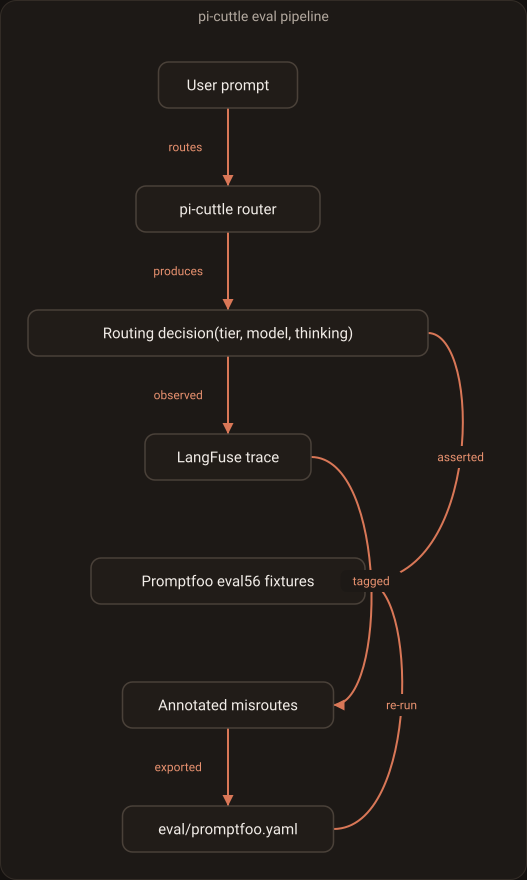

# Evaluation Guide

This document describes the pi-cuttle evaluation pipeline.

## Two-layer evaluation pipeline

The pipeline has two layers with different jobs and different requirements. Keep them
distinct — conflating them produces green results that measure nothing about routing
quality.

| Layer | What it exercises | Model needed? | Runner | Status |
|---|---|---|---|---|
| **Layer 1 — routing policy** | policy, thresholds, thinking-level clamping, subagent override, flavor selection, gates, `/cuttle why` | **no** | GitHub-hosted | ✅ running |
| **Layer 2 — decision model** | the configured classifier's real accuracy over `eval/corpus.jsonl` | **yes** | self-hosted / manual | ✅ `npm run eval --live` |

**Layer 1** drives the router through a **mocked model registry** (`eval/pi-cuttle-provider.ts`)
and asserts the deterministic decision machinery. It is fast (~1.5 s for 56 fixtures),
needs no server, and gates every PR. It does **not** invoke the decision model.

**Layer 2** scores the real classifier against the labelled corpus. It needs a reachable
classifier host (LM Studio / llama.cpp / ollama with a decision model loaded), so it runs on a
self-hosted machine or scheduler, not on every PR. The classifier is resolved in two steps:

1. **pi's own catalog** — `ModelRuntime` + `ModelRegistry` over `~/.pi/agent/{auth,models}.json`,
   used when pi exposes the configured classifier, so provider/auth handling stays pi's.
2. **Direct fallback** — some providers (notably `llama.cpp`) are registered by a runtime
   extension a standalone script cannot load; `PI_LIVE_EVAL_BASE_URL` then supplies the host's
   OpenAI-compatible base URL.

Either way the classification runs through pi's own implementation
(`@earendil-works/pi-ai/api/llama-cpp-classify`); the eval never sends its own HTTP prompt, so
the score measures the model pi runs. It reports corpus accuracy and both asymmetric misroute
counts for the classifier and the heuristic baseline. Model version/digest metadata is printed
when pi's catalog provides it; the configured ref and resolved pi model id are always printed.

Classification uses pi's deterministic label-probability path. The eval omits `temperature`:
pi defines it as a positive softmax divisor over label log-probabilities (not sampling
randomness), and zero is rejected. There is no per-prompt exact-tier CI gate; use the corpus
summary for comparisons. Layer 2 is manual/scheduled on a self-hosted machine, not a per-PR gate.

> **Honest caveat.** `eval/corpus.jsonl` scores the signal-based heuristic at 100%, but
> `eval/BASELINE.md` records that the heuristic was **tuned against that corpus**. A tuned-to
> corpus measures memorisation, not generalisation. #98 adds a holdout set so both layers
> are scored on data neither was tuned on.

## Overview

The eval pipeline verifies that pi-cuttle's routing decisions match expectations
across all 0.5.0 features: complexity scoring, thinking-level clamping, subagent
policy override, flavor routing, `/cuttle why`, `localBias`, `enforceUserCeiling`,
and edge cases.



**Flow (Layer 1):**
1. A user prompt is routed by pi-cuttle, producing a decision (tier, model, thinking level).
2. The decision is asserted against 56 Promptfoo fixtures.
3. The same decision is sent to LangFuse as a trace.
4. Annotated misroutes in LangFuse are exported back into the fixture corpus.
5. Re-running the eval verifies that fixes do not regress.

**Key metrics:**
- **Accuracy**: percentage of fixtures that pass all assertions.
- **Misroute count**: user-flagged routing decisions exported from LangFuse.
- **Latency**: per-fixture routing time (Promptfoo captures this automatically).

## Quick Start

```bash
# Run the full evaluation suite
npm run eval:promptfoo

# View results in browser
npm run eval:promptfoo:view

# Convert legacy corpus to Promptfoo format
npm run eval:convert

# Export misroutes from LangFuse and run them
npm run eval:export-misroutes 7
npm run eval:convert-misroutes
npm run eval:promptfoo:misroutes
```

## Fixture Format

Fixtures are defined in `eval/promptfoo.yaml` in Promptfoo-compatible YAML format:

```yaml
tests:
  - vars:
      prompt: "rename the variable `usrCnt` to `userCount`"
      thinkingLevel: high
    assert:
      - type: javascript
        value: output.tier === 'local'
      - type: javascript
        value: output.thinkingLevel === 'off'
    metadata:
      category: complexity
      expectedScoreRange: [0, 0.2]
```

### Test Fields

- **vars.prompt**: The user prompt to evaluate.
- **vars.flavor**: Optional virtual model flavor (`auto`, `local`, `cloud`, `fast-local`, `big-local`, `orchestrator`).
- **vars.thinkingLevel**: Optional user thinking-level ceiling; use `high` when testing thinking-level clamping so the ceiling does not hide the mapped level.
- **vars.isSubagent**: Set to `true` to simulate `PI_SUBAGENT_CHILD=1` and trigger the subagent policy override.
- **assert**: Array of JavaScript assertions evaluating the routing output.
- **metadata**: Optional test metadata for categorization and debugging.

### Output Schema

The custom provider (`eval/pi-cuttle-provider.ts`) returns a JSON object with:

```typescript
interface RoutingOutput {
  tier: "local" | "cloud";
  modelId: string;
  flavor: "auto" | "local" | "cloud" | "fast-local" | "big-local" | "orchestrator";
  thinkingLevel: "off" | "minimal" | "low" | "medium" | "high" | "xhigh" | "max";
  decision: {
    source: "classifier" | "heuristic" | "pin";
    reason: string;
    score?: number;
  };
  isSubagent: boolean;
  localBiasApplied: boolean;
  userCeilingRespected: boolean;
  requestedThinkingLevel?: string;
  effectiveThinkingLevel: string;
  complexityScore?: number;
}
```

## Fixture Categories

The test suite covers all pi-cuttle 0.5.0 features:

1. **Complexity Scoring** (12 fixtures): Simple vs complex prompts.
2. **Thinking-Level Clamping** (8 fixtures): Prompts at various complexity levels mapped to `off`, `low`, `medium`, `high`.
3. **Subagent Policy Override** (6 fixtures): Subagent role detection forces local routing.
4. **Flavor Routing** (16 fixtures):
   - `big-local` (4): Selects the largest local model (`bonsai-27b`).
   - `orchestrator` (4): Current behavior routes local; fixtures assert documented behavior.
   - `fast-local` (4): Selects the smallest local model (`muse-glimmer`).
   - `auto` (4): Default routing behavior.
5. **`/cuttle why` Support** (4 fixtures): Decision metadata must be present and explainable.
6. **`localBias` Configuration** (3 fixtures): Borderline mixed-signal prompts stay local because of bias.
7. **`enforceUserCeiling`** (3 fixtures): Output thinking level respects the user's `/thinking` selection.
8. **Edge Cases** (4 fixtures): Empty prompts, single characters, very long prompts, minimal input.

Total: 56 fixtures.

### Example: Adding a Thinking-Level Fixture

```yaml
  - vars:
      prompt: "explain the threading model in Node.js"
      thinkingLevel: high
    assert:
      - type: javascript
        value: output.thinkingLevel === 'medium'
    metadata: { category: thinking-levels }
```

### Example: Adding a Flavor Fixture

```yaml
  - vars:
      prompt: "review this PR for concurrency bugs"
      flavor: orchestrator
      thinkingLevel: high
    assert:
      - type: javascript
        value: output.flavor === 'orchestrator'
      - type: javascript
        value: output.tier === 'local'
    metadata: { category: flavor-orchestrator }
```

## Running Eval

### Local

```bash
# Full Promptfoo eval
npm run eval:promptfoo

# View the HTML report
npm run eval:promptfoo:view

# Heuristic-only Layer 1 score (unchanged; no pi classifier or host required)
npm run eval

# Live Layer 2 classifier score (requires the configured classifier + a reachable host)
npm run eval --live
# Same, when the classifier is not in pi's catalog (e.g. a llama.cpp classifier):
PI_LIVE_EVAL_BASE_URL=http://127.0.0.1:9931/v1 npm run eval --live
# Equivalent explicit script
npm run eval:live
```

### CI

Layer 1 runs on every push to `main` and on every PR via `.github/workflows/eval.yml`:

```yaml
- name: Routing-policy eval (heuristic layer)
  run: npm run eval:promptfoo

- name: Upload eval results
  uses: actions/upload-artifact@v4
  with:
    name: eval-results
    path: eval/results.json
```

Layer 2 (`npm run eval --live`) is not part of the per-PR gate. Run it on a machine with
pi-cuttle's `classifier.model` configured and the classifier host reachable. Missing
configuration, an unresolvable classifier, or a failed request exits non-zero with a diagnostic.

## Layer 2: Live Classifier Eval

Run `npm run eval --live` (or `npm run eval:live`) to score `eval/corpus.jsonl` through pi's
own classifier implementation.

### Resolution order

1. **pi's catalog.** The command builds pi's `ModelRuntime.create({ authPath, modelsPath })` and
   `ModelRegistry` from `~/.pi/agent/{auth,models}.json` and uses the classifier when pi's
   catalog exposes it. The classifier ref comes from `pi-cuttle.json` (project config wins).
2. **Direct fallback.** Some providers — `llama.cpp` among them — are registered by a runtime
   extension, so a standalone script cannot see them even though pi resolves them fine at
   runtime. When the catalog returns nothing, supply the host's OpenAI-compatible base URL:

   ```bash
   PI_LIVE_EVAL_BASE_URL=http://127.0.0.1:9931/v1 npm run eval --live
   ```

Both paths call pi's classifier implementation (`@earendil-works/pi-ai/api/llama-cpp-classify`).
The eval never sends its own HTTP prompt, so the score measures the model pi runs — and the
report prints which path resolved the classifier.

### Output

The classifier ref, resolved model id/API, any version/digest pi exposes, the classifier
accuracy and confusion counts, and the heuristic baseline under the same policy threshold.
`local -> cloud` is wasted spend; `cloud -> local` is quality risk. A version or weight digest
absent from pi's classifier catalog is reported as unavailable rather than guessed from an HTTP
response.

### Failure behaviour

No classifier configured, neither path resolvable, a timeout, or a failed host request exits
non-zero with a diagnostic. It never silently falls back to the heuristic and reports that as
the classifier score.

### Determinism

The classifier path is a deterministic forward pass over label probabilities. The command
omits `temperature`: pi interprets it as the softmax divisor (which must be positive), not a
generation sampling temperature, and passing zero is invalid. Pin the model and compare
corpus-level accuracy and confusion counts; do not gate CI on individual fixture tiers.

### Measured baseline (2026-10-18)

`llama.cpp/ggml-org/Kev-9B-GGUF:Q8_0` on llama-server scored **93.8%** over the 112-prompt
corpus (1 `local→cloud`, 6 `cloud→local`), against the tuned heuristic's **100%**. The six
`cloud→local` misses are the quality-risk direction. See `eval/BASELINE.md` and #97.

## Interpreting Results

Promptfoo prints a table with each prompt, the routing output, and pass/fail status.
At the bottom it reports:

```
Results:
  ✓ 56 passed (100%)
  ✗ 0 failed (0%)
  0 errors (0%)
```

If a fixture fails:
1. Find the failing prompt in the table.
2. Check the actual `output.tier`, `output.thinkingLevel`, and `output.modelId`.
3. Compare against the assertion and the fixture's `metadata`.
4. Decide whether the fixture expectation is wrong or the router behavior is wrong.

## Debugging Failing Fixtures

1. **Run the provider in isolation:**
   ```bash
   node --experimental-strip-types -e "
   import { heuristicScore } from './src/classifier.ts';
   console.log(heuristicScore('your prompt here'));
   "
   ```

2. **Inspect a single fixture with Promptfoo:**
   Temporarily remove all other fixtures from `eval/promptfoo.yaml` and run:
   ```bash
   npm run eval:promptfoo
   ```

3. **Check the provider output:**
   The Promptfoo table shows the full JSON output for each failing test.

4. **Common issues:**
   - Wrong tier: check `policy.threshold` and `policy.localBias` in the provider config.
   - Wrong thinking level: check `thinkingLevels.map` thresholds and ensure `vars.thinkingLevel` is set to `high` when testing the full mapped level.
   - Wrong model: check `capabilities` in the provider config; `big-local` sorts by capability descending, `fast-local` ascending.

## Adding Test Categories

1. Add a new `metadata.category` value (e.g., `my-feature`).
2. Add fixtures under a new commented section in `eval/promptfoo.yaml`.
3. Update the category list in this document.
4. Run `npm run eval:promptfoo` and commit only when all fixtures pass.

## Observability and Feedback Loop

Routing decisions are sent to LangFuse when `observability.enabled` is true in
`pi-cuttle.json` (see `docs/CONFIG.md`). Each trace contains:

- Chosen tier, model, flavor, and thinking level
- Complexity score and decision source
- Subagent flag and policy overrides in effect

To use this for continuous improvement:

1. Start LangFuse: `npm run langfuse:up`
2. Enable observability in your pi-cuttle config
3. Tag misrouted traces with `misroute` in the LangFuse UI (and optionally set
   `correctTier` in the trace metadata)
4. Export misroutes:
   ```bash
   npm run eval:export-misroutes 7   # last 7 days
   npm run eval:convert-misroutes    # convert to Promptfoo format
   ```
5. Run the misroute regression eval:
   ```bash
   npm run eval:promptfoo:misroutes
   ```
6. Once fixes are verified, promote fixtures from `eval/misroutes-promptfoo.yaml`
   into `eval/promptfoo.yaml` so they are enforced by the main eval.

## Migration from Legacy Eval

The legacy eval system (`eval/run.ts`, `eval/score.ts`, `eval/corpus.jsonl`) is still
available via `npm run eval` but is no longer the source of truth for new features.
To migrate:

1. Run `npm run eval:convert` to convert `corpus.jsonl` to `eval/corpus-promptfoo.yaml`.
2. Review the generated fixtures.
3. Add category-specific tests to `eval/promptfoo.yaml`.
4. Run both systems in parallel during transition.

## Child-launch fixtures (#131)

`eval/child-launch-fixtures.json` is the Langfuse crashes where a foreground child died on
`cuttle/local:high` (and the same shape with other flavors). `npm run eval:child-launch` registers
the router with the installed pi-subagents and checks the launch plan. It does not start a child
and does not call a model. It needs pi-subagents on the machine; without it the command exits 2
instead of pretending the check passed.

## References

- `docs/CONFIG.md` — observability configuration
- `docs/LANGFUSE.md` — self-hosting LangFuse
- `eval/pi-cuttle-provider.ts` — custom Promptfoo provider
