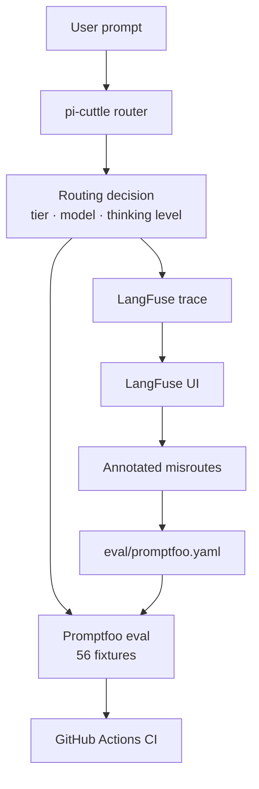
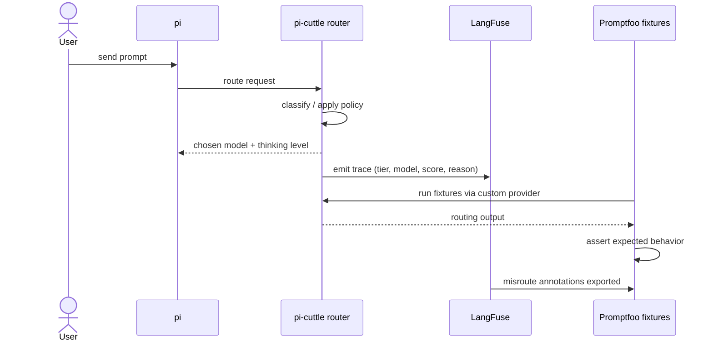

# Eval Pipeline Architecture

This document describes the architecture of the pi-cuttle evaluation and observability pipeline.

## High-level flow



## Components

### 1. pi-cuttle router

The router receives every user turn and decides:
- Which **tier** should serve it (`local` or `cloud`)
- Which **physical model** should run it
- Which **thinking level** to request
- Whether a **subagent policy override** applies

This decision is made by `routeRequest()` in `src/virtual-models.ts`.

### 2. Promptfoo eval

`eval/promptfoo.yaml` contains 56 fixtures that assert routing behavior for all 0.5.0 features:
- Complexity scoring
- Thinking-level clamping
- Subagent policy override
- Flavor routing (`auto`, `fast-local`, `big-local`, `orchestrator`)
- `/cuttle why` decision metadata
- `localBias`
- `enforceUserCeiling`
- Edge cases

The custom provider `eval/pi-cuttle-provider.ts` calls `routeRequest()` with a mocked `ExtensionContext` so no live model server is needed for routing assertions.

Run with:

```bash
npm run eval:promptfoo
```

### 3. LangFuse observability

Every routing decision is sent to LangFuse as a trace containing:
- Chosen tier, model, flavor, and thinking level
- Complexity score and decision source
- Subagent flag and policy overrides

LangFuse runs locally via Docker Compose (`docker-compose.langfuse.yml`).

Start with:

```bash
npm run langfuse:up
```

### 4. Feedback loop

Misrouted traces are tagged `misroute` in the LangFuse UI. They are exported back into the eval corpus:

```bash
npm run eval:export-misroutes 7
npm run eval:convert-misroutes
npm run eval:promptfoo:misroutes
```

Verified misroutes are promoted into `eval/promptfoo.yaml` so the main eval enforces them.

### 5. CI gate

On push/PR, GitHub Actions runs:

```bash
npm run typecheck
npm test
npm run eval:promptfoo
```

The eval must remain green; new fixtures should only be added when they improve coverage or verify a fix.

## Data flow detail



## Files

| File | Purpose |
|---|---|
| `eval/promptfoo.yaml` | Main fixture corpus |
| `eval/pi-cuttle-provider.ts` | Custom Promptfoo provider |
| `eval/export-misroutes.ts` | Fetch misroutes from LangFuse |
| `eval/convert-misroutes.ts` | Convert misroutes to Promptfoo format |
| `src/langfuse.ts` | Minimal LangFuse HTTP client |
| `docker-compose.langfuse.yml` | Local LangFuse v3 stack |
| `docs/EVAL.md` | Full eval user guide |
